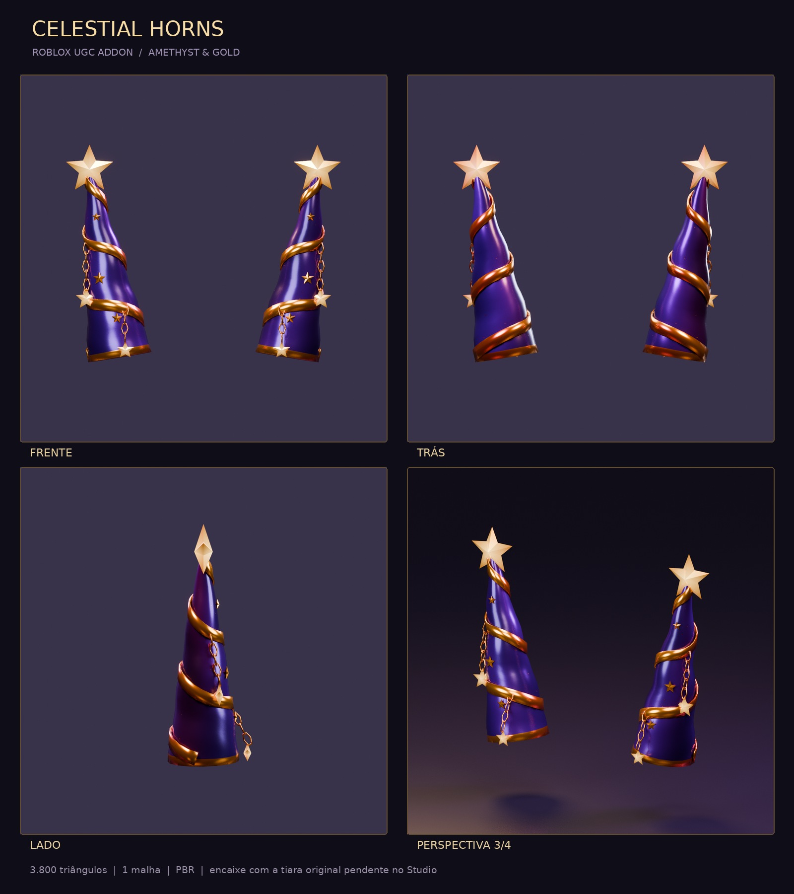

# Celestial Horns — Roblox UGC Addon

Modelo 3D real de **dois chifres de ametista com fitas helicoidais douradas**, duas estrelas de cinco pontas no topo, seis estrelas decorativas e quatro estrelas pendentes em correntes. Não inclui uma segunda faixa nem fogos artificiais novos: foi desenhado para ser equipado junto à tiara original.

[Baixar o projeto completo em ZIP](https://github.com/matheusbranco711-hue/Roblox-UGC-Celestial-Horns/archive/refs/heads/main.zip)



**Estado da entrega:** gerado e renderizado no Blender 4.3.2 em Linux. Os formatos `.blend`, `.fbx` e `.obj` passaram por abertura/reimportação e verificação de geometria no Blender; consulte `verification_report.json`. **O encaixe com a tiara original e a publicação UGC ainda não foram validados no Roblox Studio.** Os centros iniciais das estrelas são estimativas da referência visual, não coordenadas extraídas do item original.

Tiara de referência: [Diwali Sparkler Headband — 81550816889926](https://www.roblox.com/pt/catalog/81550816889926/Diwali-Sparkler-Headband). O mesh e os efeitos desse item não são redistribuídos neste projeto.

## Arquivos entregues

```text
Roblox-UGC-Celestial-Horns/
├── Celestial_Horns_Addon.blend
├── Celestial_Horns_Addon.fbx
├── Celestial_Horns_Addon.obj
├── Celestial_Horns_Addon.mtl
├── create_celestial_horns.py
├── fit_parameters.json
├── fit_manifest.json
├── quality_report.json
├── verification_report.json
├── fit_parameter_verification.json
├── README.md
├── Textures/
│   ├── Celestial_ColorMap.png
│   ├── Celestial_MetalnessMap.png
│   ├── Celestial_RoughnessMap.png
│   ├── Celestial_NormalMap.png
│   └── Celestial_EmissiveMask.png
├── Renders/
│   ├── 00_Presentation.jpg
│   ├── 01_Front.png
│   ├── 02_Back.png
│   ├── 03_Side.png
│   └── 04_Three_Quarter.png
├── Studio/
│   ├── prepare_import.luau
│   ├── measure_original_stars.luau
│   └── check_star_alignment.luau
└── Tools/
    ├── rebuild_from_guides.py
    ├── verify_exports.py
    ├── verify_fit_parameters.py
    └── prepare_delivery.py
```

Ao abrir o `.blend`, ative **Material Preview** para ver as cores e os metais na viewport; **F12** renderiza a câmera de apresentação. As quatro vistas são renders do mesh exportado, sem imagem conceitual substituindo a geometria. A câmera, o chão, as luzes e os guias ficam em coleções próprias e são excluídos do FBX/OBJ. O `.blend` contém as cinco imagens de textura empacotadas, além dos PNGs externos.

## Geometria e limites conferidos

- **3.800 triângulos**, abaixo do limite oficial de 4.000 para acessórios rígidos.
- Uma malha de exportação, um material PBR e um conjunto UV dentro de 0–1.
- Dois chifres distintos dentro desse mesh, selecionáveis pelos grupos de vértices `LEFT_Horn` e `RIGHT_Horn`; fitas, estrelas e elos também têm grupos próprios.
- 34 componentes de superfície fechada; todos fazem parte do mesmo objeto rígido. Os elos e ornamentos são geometria estática, sem Parts soltas ou física de correntes.
- Sem bordas não manifold, vértices soltos ou faces de área zero; normais orientadas para fora.
- Escala inicial destinada a **Hat / Classic**. O relatório compara os limites centrados no attachment, não só a dimensão total. O preset inicial não cabe no limite de Hat / Normal; redimensione e refaça o encaixe caso queira outra escala de corpo.
- A origem de autoria corresponde ao `HatAttachment` de referência. A geometria do addon é deslocada acima dessa origem, portanto não centralize a geometria na origem durante a edição.

Os valores exatos de tamanho e centro geométrico estão em `fit_manifest.json`. `Studio/prepare_import.luau` contém os mesmos valores para corrigir qualquer conversão de unidades no importador. O gerador atualiza esses valores automaticamente quando o helper existe na pasta de saída. `Tools/prepare_delivery.py` também pode atualizá-los.

## Importação simples no Roblox Studio

1. Crie um manequim Classic e nomeie-o `CelestialFitRig`. Equipe a **tiara original** nesse manequim para os testes de sobreposição.
2. Importe `Celestial_Horns_Addon.fbx` pelo **3D Importer**, preservando a orientação do arquivo e usando `Rig Scale > Default` quando essa opção aparecer. O arquivo contém somente o objeto `Celestial_Horns_Handle`. O FBX usa `FBX Unit Scale`, eixos `-Z Forward / Y Up` e textura de cor embutida.
3. Confira o tamanho em studs com `fit_manifest.json`. Para aplicar tamanho e posição de referência, selecione apenas o MeshPart importado e execute o conteúdo de `Studio/prepare_import.luau` na **Command Bar do Studio**. Esse helper prepara um mesh ancorado para ajuste; ele não cria um acessório já validado.
4. Faça upload dos PNGs. No MeshPart, crie/configure um **SurfaceAppearance** com os mapas abaixo. O ColorMap pode ser reconhecido na importação, mas confira os demais mapas manualmente.
5. Use o **Accessory Fitting Tool** para converter o mesh em acessório rígido do tipo **Hat**, na escala **Classic**, e configurar o `HatAttachment` na superfície da cabeça. Os empties do Blender são guias de autoria: o Roblox não importa automaticamente attachments de acessórios rígidos a partir deles.
6. Equipe o acessório gerado junto com a tiara original no mesmo manequim. Verifique a frente, os lados, as costas, a cobertura das hastes e a continuidade dos fogos. Teste também com o cabelo pretendido.
7. Antes de publicar, remova guias temporários e mantenha o acessório final sem Scripts ou Parts extras, com o Handle desancorado, `Material = Plastic`, `Transparency = 0` e cor branca. Execute a validação do Studio/AFT para a conta e os requisitos atuais do Marketplace.

| Propriedade do SurfaceAppearance | Arquivo | Resolução |
| --- | --- | --- |
| `ColorMap` | `Celestial_ColorMap.png` | 1024 × 1024 RGB |
| `MetalnessMap` | `Celestial_MetalnessMap.png` | 256 × 256, cinza 8 bits |
| `RoughnessMap` | `Celestial_RoughnessMap.png` | 256 × 256, cinza 8 bits |
| `NormalMap` | `Celestial_NormalMap.png` | 256 × 256 RGB, OpenGL tangente |
| `EmissiveMaskContent` | `Celestial_EmissiveMask.png` | 256 × 256, cinza 8 bits |

O normal map é deliberadamente neutro: os volumes, as facetas das estrelas e as fitas estão na geometria. As UVs de partes repetidas compartilham regiões do atlas, o que é permitido pela documentação.

A emissão do shader Blender **não é transferida automaticamente**. A documentação atual do Roblox permite máscara emissiva em itens do Marketplace. Atribua `EmissiveMaskContent` pelo seletor de conteúdo em **Properties**, comece com `EmissiveStrength = 1.7` e `EmissiveTint` branco, e confira sob diferentes iluminações. O valor documentado para validação do Marketplace é 0–40. A API declara a escrita do conteúdo da máscara como `PluginSecurity`; não coloque um Script de jogo tentando configurá-la. Se a propriedade não estiver disponível na instalação do Studio, o ColorMap continua fornecendo estrelas douradas claras; atualize o Studio para usar a máscara. Não são necessárias Parts Neon adicionais no acessório UGC.

## Alinhamento exato com a tiara original

As imagens não determinam profundidade ou coordenadas 3D. Os guias `LEFT_ORIGINAL_STAR_TARGET` e `RIGHT_ORIGINAL_STAR_TARGET` começam em posições estimadas. Uma coincidência com esses guias no Blender não valida a coincidência com o item original.

**Fluxo recomendado com medidas do item real:**

1. Com a tiara original equipada em `CelestialFitRig`, determine os centros reais das duas estrelas. Use coordenadas da geometria original ou guias cuja posição tenha sido conferida sobre o mesh. Um attachment de partículas só serve como referência se você confirmar que ele coincide com o centro da estrela.
2. Coloque dois Attachments temporários no Handle original, nesses centros, chamados `CelestialTarget_LEFT` e `CelestialTarget_RIGHT`. Neste projeto, `LEFT` identifica o lado de X negativo no referencial de `Head.HatAttachment`; use esse critério em ambos os itens.
3. Execute `Studio/measure_original_stars.luau`. Ele imprime os alvos em coordenadas Blender relativas a `Head.HatAttachment`. Copie `LEFT_STAR_TARGET` e `RIGHT_STAR_TARGET` para `fit_parameters.json`, preservando os demais parâmetros.
4. Mantenha `LEFT_STAR_OFFSET` e `RIGHT_STAR_OFFSET` zerados para prender os centros das novas estrelas aos alvos. Reexecute o gerador. Ele deforma suavemente cada chifre até seu alvo após aplicar rotação e escala independentes, preservando a base.
5. Reimporte, aplique o novo tamanho/centro do manifesto e confira os dois acessórios equipados juntos. Adicione guias temporários `CelestialAddon_LEFT` e `CelestialAddon_RIGHT` nos centros das novas estrelas. Execute `Studio/check_star_alignment.luau` para obter o erro em studs. A precisão desse resultado depende da precisão de colocação dos guias.
6. Ajuste corpo, curvatura, bases e espessura até cobrir as hastes. Conferir apenas os dois centros não garante cobertura de toda a haste. Inspecione em 360°, teste os efeitos e remova os guias temporários antes da publicação.

**Alternativa no Blender:** importe uma cópia autorizada da referência 3D, alinhe seu HatAttachment à origem e confira a escala. Mova os dois empties de alvo até os centros medidos das estrelas. No Text Editor, execute `Tools/rebuild_from_guides.py`: ele salva os alvos no JSON, reconstrói e exporta sem renderizar. Objetos de referência fora das três coleções geradas são preservados pelo gerador. Mantenha a referência em uma coleção separada e oculte-a dos renders se quiser vistas apenas do addon.

Convenções: Blender **Z para cima, +Y para frente**; exportação Roblox **Y para cima, -Z para frente**. Conversão de coordenadas: Roblox `(x, y, z) = Blender (x, z, -y)`. Todas as posições do JSON são relativas ao HatAttachment, em unidades de modelagem interpretadas como studs alvo. Rotações no JSON usam graus Euler XYZ.

## Parâmetros disponíveis

| Parâmetro | Controle |
| --- | --- |
| `HORN_HEIGHT`, `HORN_SPACING`, `HORN_CURVATURE` | Altura, separação das bases e abertura dos chifres |
| `SPIRAL_TURNS` | Voltas das fitas e torção sutil do corpo |
| `STAR_SCALE` | Raio global das duas estrelas superiores |
| `HEAD_POSITION_OFFSET` | Deslocamento comum das bases |
| `LEFT/RIGHT_POSITION_OFFSET` | Deslocamento individual da base |
| `LEFT/RIGHT_HORN_ROTATION` | Rotação individual do chifre, em graus |
| `LEFT/RIGHT_HORN_SCALE` | Escala XYZ individual do chifre |
| `LEFT/RIGHT_TIP_OFFSET` | Deslocamento da ponta quando o alvo explícito é `null` |
| `LEFT/RIGHT_STAR_TARGET` | Centro medido da estrela original; tem prioridade sobre `TIP_OFFSET` |
| `LEFT/RIGHT_STAR_ROTATION` | Rotação independente da estrela ao redor de seu próprio centro |
| `LEFT/RIGHT_STAR_SCALE` | Escala XYZ independente da estrela |
| `LEFT/RIGHT_STAR_OFFSET` | Deslocamento extra da estrela; zero preserva o alvo exato |

Os campos com `LEFT/RIGHT` correspondem a dois parâmetros separados, por exemplo `LEFT_HORN_SCALE` e `RIGHT_HORN_SCALE`. As constantes adicionais de malha, raio, resolução e render ficam no início do script. Aumentar segmentos pode exceder 4.000 triângulos: o gerador verifica o orçamento antes de exportar. Depois de qualquer alteração, leia novamente os relatórios de geometria e limites.

## Reconstruir no Blender do Windows

Extraia a pasta completa. Não é necessário instalar dependências para o gerador: ele usa `bpy`, `mathutils` e NumPy incluídos no Blender. No PowerShell, ajuste apenas o caminho do executável se sua versão estiver em outra pasta:

```powershell
cd "C:\Projetos\Roblox-UGC-Celestial-Horns"
& "C:\Program Files\Blender Foundation\Blender 4.3\blender.exe" --background --threads 8 --python .\create_celestial_horns.py -- --output . --config .\fit_parameters.json --render-size 1200 --samples 128
```

Para reconstruir rapidamente sem renders:

```powershell
& "C:\Program Files\Blender Foundation\Blender 4.3\blender.exe" --background --python .\create_celestial_horns.py -- --output . --config .\fit_parameters.json --no-render
```

Para verificar abertura/reimportação dos arquivos padrão:

```powershell
& "C:\Program Files\Blender Foundation\Blender 4.3\blender.exe" --background --python .\Tools\verify_exports.py -- "$PWD"
```

A verificação de round-trip incluída compara os arquivos do preset entregue de 3.800 triângulos. Se você alterar a resolução geométrica ou introduzir assimetria intencional, adapte esses dois critérios no verificador. O `quality_report.json` é recalculado pelo gerador para qualquer preset.

No Linux, o comando usado para a entrega foi:

```bash
blender -b --threads 8 --python create_celestial_horns.py -- --output . --render-size 1200 --samples 128
blender -b --python Tools/verify_exports.py -- "$PWD"
python Tools/prepare_delivery.py
```

`Tools/prepare_delivery.py` usa Pillow apenas para montar a prancha JPEG a partir dos quatro renders e atualizar os números do helper Studio. Essa ferramenta é opcional; o gerador Blender produz todos os formatos obrigatórios e os quatro PNGs sem ela. O denoiser é ativado somente se o build Blender oferecer OpenImageDenoise.

## Documentação oficial consultada

Requisitos conferidos em **17/10/2026**, nos arquivos oficiais de `Roblox/creator-docs`. Confira novamente antes de publicar; esses requisitos podem mudar.

- [Rigid accessory specifications](https://create.roblox.com/docs/avatar/rigid-accessories/specifications) — uma malha, 4k triângulos, superfícies fechadas, dimensões por escala, HatAttachment, Material Plastic e ausência de objetos extras.
- [Fonte oficial dos requisitos rígidos](https://github.com/Roblox/creator-docs/blob/main/content/en-us/avatar/rigid-accessories/specifications.md) — Classic Hat: **3 × 4 × 3 studs**, centrados no attachment. Normal Hat: **1,87 × 2,5 × 1,87**.
- [Export rigid accessories](https://create.roblox.com/docs/avatar/rigid-accessories/export) — `FBX Unit Scale`, cópia de texturas e fluxo de importação.
- [Texture specifications](https://create.roblox.com/docs/art/modeling/texture-specifications) — material e UV únicos, formatos PNG e orçamento de **256 × 256 para mapas não albedo** de acessórios rígidos. O atlas de cor entregue é 1024 × 1024, dentro dos limites documentados.
- [Surface appearance — emissive mask](https://create.roblox.com/docs/art/modeling/surface-appearance#emissive-mask) — suporte a máscara emissiva em itens do Marketplace e força de emissão entre 0 e 40.
- [SurfaceAppearance API](https://github.com/Roblox/creator-docs/blob/main/content/en-us/reference/engine/classes/SurfaceAppearance.yaml) — propriedades atuais de emissão e permissões de escrita.

Os testes entregues cobrem os arquivos e a geometria no Blender. Não cobrem a conta de publicação, validação automática do Marketplace, comparação com o mesh original, comportamento de fogos ou teste em execução no Roblox Studio.
